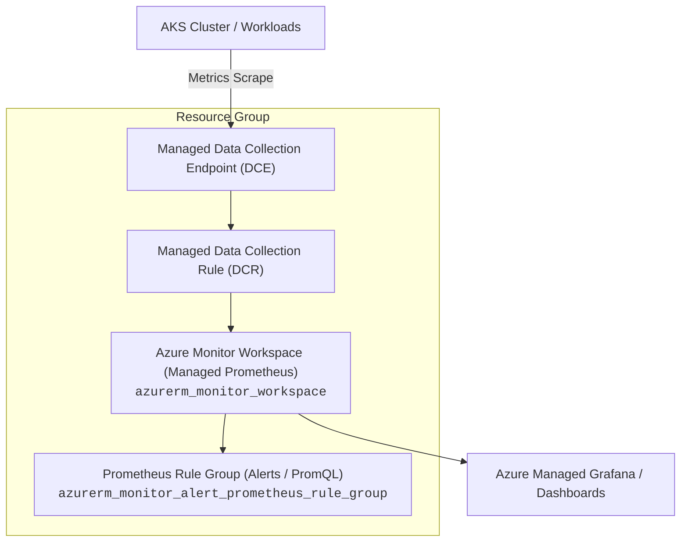

# Azure Monitor Workspace Terraform Module

This module provides an enterprise-ready, reusable Terraform configuration for provisioning an **Azure Monitor Workspace** (`azurerm_monitor_workspace`), dedicated to Azure Managed Prometheus metrics, along with optional Prometheus Alert and Recording Rule Groups (`azurerm_monitor_alert_prometheus_rule_group`).

---

## Architecture Overview



---

## Features

- **Decoupled & Generic:** Clean separation of concerns with no project-specific hardcoding.
- **Managed Prometheus:** Full support for Azure Managed Prometheus backend workspace.
- **Rule Groups Integration:** Built-in dynamic support for PromQL alerting and recording rules (`azurerm_monitor_alert_prometheus_rule_group`).
- **Secure Networking:** Configurable `public_network_access_enabled` flag.
- **Comprehensive Outputs:** Exports workspace ID, query endpoint, default DCE ID, default DCR ID, and alert rule group IDs.

---

## Usage Examples

### 1. Basic / Standard Prometheus Workspace

```hcl
module "monitor_workspace" {
  source = "../../modules/monitor_workspace"

  name                = "amw-enterprise-dev-eastus2"
  resource_group_name = module.resource_group["app"].name
  location            = module.resource_group["app"].location

  public_network_access_enabled = true

  tags = {
    Environment = "Development"
    ManagedBy   = "Terraform"
  }
}
```

### 2. Workspace with Prometheus PromQL Alert Rules

```hcl
module "monitor_workspace" {
  source = "../../modules/monitor_workspace"

  name                = "amw-enterprise-dev-eastus2"
  resource_group_name = "rg-enterprise-dev-app-eastus2"
  location            = "eastus2"

  prometheus_rule_groups = {
    node_alerts = {
      name         = "amw-node-alerts"
      description  = "Prometheus node health alerting rules"
      cluster_name = "aks-enterprise-dev-eastus2"
      interval     = "PT1M"
      rules = [
        {
          alert      = "NodeHighCpuUsage"
          expression = "100 - (avg by (instance) (irate(node_cpu_seconds_total{mode=\"idle\"}[5m])) * 100) > 85"
          severity   = 2
          for        = "PT5M"
          labels = {
            severity = "warning"
          }
          annotations = {
            description = "Node CPU usage exceeds 85% for more than 5 minutes."
          }
        }
      ]
    }
  }

  tags = {
    Environment = "Development"
  }
}
```

---

## Requirements

| Name | Version |
| :--- | :--- |
| **terraform** | `>= 1.5.0` |
| **azurerm** | `>= 3.75.0, < 5.0.0` |

---

## Inputs

| Name | Description | Type | Default | Required |
| :--- | :--- | :--- | :--- | :---: |
| `name` | Specifies the name of the Azure Monitor Workspace. | `string` | n/a | **yes** |
| `resource_group_name` | The name of the resource group in which the Azure Monitor Workspace should exist. | `string` | n/a | **yes** |
| `location` | The Azure Region where the Azure Monitor Workspace should exist. | `string` | n/a | **yes** |
| `public_network_access_enabled` | Specifies whether public network access is enabled for the Azure Monitor Workspace. | `bool` | `true` | no |
| `prometheus_rule_groups` | Map of Prometheus alert and recording rule groups to configure for this Azure Monitor workspace. | `map(object)` | `{}` | no |
| `tags` | A mapping of tags which should be assigned to the Azure Monitor Workspace and associated resources. | `map(string)` | `{}` | no |

---

## Outputs

| Name | Description |
| :--- | :--- |
| `id` | The ID of the Azure Monitor Workspace. |
| `name` | The Name of the Azure Monitor Workspace. |
| `query_endpoint` | The query endpoint URL for the Azure Monitor Workspace. |
| `default_data_collection_endpoint_id` | The ID of the managed default Data Collection Endpoint created with the workspace. |
| `default_data_collection_rule_id` | The ID of the managed default Data Collection Rule created with the workspace. |
| `prometheus_rule_group_ids` | Map of created Prometheus rule group names to their resource IDs. |
