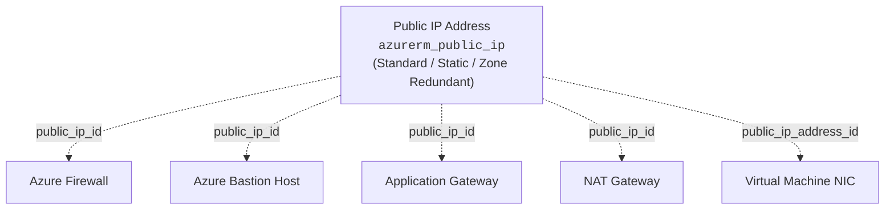

# Azure Public IP Terraform Module

This module provides a production-grade, generic Terraform child module for managing **Azure Public IP Addresses** (`azurerm_public_ip`).

Decoupling Public IPs from downstream workloads (e.g. Azure Firewall, Bastion Host, Application Gateway, NAT Gateway, Virtual Machines) ensures:
- **IP Lifecycle Persistence:** Rebuilding a VM, Firewall, or Bastion does not destroy or change its Public IP, protecting DNS records and firewall allowlists.
- **Enterprise Pre-Allocation:** Security and Network teams can pre-allocate static IPs with availability zone redundancy before application rollout.
- **DDoS & Prefix Ready:** Supports Public IP Prefixes, Custom Domain FQDNs, Reverse DNS, and DDoS Protection.

---

## Architecture



---

## Features

- **Standard SKU & Static Allocation:** Configured by default for enterprise reliability.
- **Zone Redundancy:** Supports multi-zone allocation (e.g., `["1", "2", "3"]`).
- **DNS Integration:** Supports custom `domain_name_label` and `reverse_fqdn`.
- **Prefix & DDoS Support:** Integrates with `azurerm_public_ip_prefix` and DDoS protection plans.

---

## Usage Examples

### 1. Zone-Redundant Standard Public IP (for Firewall / Bastion / AppGW)

```hcl
module "public_ip" {
  source = "../../modules/public_ip"

  name                = "pip-firewall-prod"
  resource_group_name = "rg-network-prod"
  location            = "eastus2"
  allocation_method   = "Static"
  sku                 = "Standard"
  zones               = ["1", "2", "3"]

  tags = {
    Environment = "Production"
    Role        = "FirewallEgress"
  }
}
```

### 2. Public IP with DNS Domain Name Label

```hcl
module "public_ip_appgw" {
  source = "../../modules/public_ip"

  name                = "pip-appgw-dev"
  resource_group_name = "rg-app-dev"
  location            = "eastus2"
  domain_name_label   = "myenterpriseapp-dev"

  tags = {
    Environment = "Development"
  }
}
```

---

## Requirements

| Name | Version |
| :--- | :--- |
| **terraform** | `>= 1.5.0` |
| **azurerm** | `>= 3.75.0, < 5.0.0` |

---

## Inputs

| Name | Description | Type | Default | Required |
| :--- | :--- | :--- | :--- | :---: |
| `name` | Specifies the name of the Public IP. | `string` | n/a | **yes** |
| `resource_group_name` | Resource group where the Public IP will be created. | `string` | n/a | **yes** |
| `location` | Azure region for the Public IP. | `string` | n/a | **yes** |
| `allocation_method` | Allocation method (`Static` or `Dynamic`). | `string` | `"Static"` | no |
| `sku` | SKU of the Public IP (`Basic` or `Standard`). | `string` | `"Standard"` | no |
| `sku_tier` | SKU Tier (`Regional` or `Global`). | `string` | `"Regional"` | no |
| `zones` | Availability Zones (e.g. `["1", "2", "3"]`). | `list(string)` | `[]` | no |
| `ip_version` | IP Version (`IPv4` or `IPv6`). | `string` | `"IPv4"` | no |
| `domain_name_label` | DNS prefix label for `<label>.<region>.cloudapp.azure.com`. | `string` | `null` | no |
| `reverse_fqdn` | Fully qualified domain name for PTR lookup. | `string` | `null` | no |
| `idle_timeout_in_minutes` | TCP idle connection timeout in minutes. | `number` | `4` | no |
| `public_ip_prefix_id` | Public IP prefix resource ID. | `string` | `null` | no |
| `ddos_protection_mode` | DDoS protection mode. | `string` | `"VirtualNetworkInherited"` | no |
| `ddos_protection_plan_id` | Associated DDoS protection plan ID. | `string` | `null` | no |
| `tags` | Map of tags to assign. | `map(string)` | `{}` | no |

---

## Outputs

| Name | Description |
| :--- | :--- |
| `id` | The ID of the Public IP. |
| `name` | The name of the Public IP. |
| `ip_address` | The allocated IP address. |
| `fqdn` | The Fully Qualified Domain Name (FQDN) assigned to the public IP. |
| `zones` | Availability Zones assigned to this Public IP. |
| `sku` | The SKU of the Public IP. |
