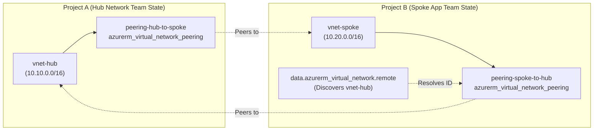

# Azure Virtual Network Peering Terraform Module

This module provides an enterprise-grade, reusable Terraform child module for managing **Azure Virtual Network Peering** (`azurerm_virtual_network_peering`).

It follows the **1-to-1 resource model** (1 child module call manages 1 peering link on the target VNet) with built-in **Data Source discovery** (`data.azurerm_virtual_network`), ensuring:
- **Zero cross-project resource duplication** (no duplicate peering resources managed in separate Terraform states).
- **Clean RBAC isolation** (each project team only needs Contributor permissions on their own VNet/Resource Group).
- **Dynamic cross-project discovery** (remote VNet can be discovered via name and resource group without hardcoding Azure resource IDs).

---

## Architecture: Multi-Project & Single-Project



---

## Usage Scenarios

### Scenario 1: Cross-Project / Separate States (Recommended for Multi-Project)

**In Project B (Spoke App Repo):**
```hcl
module "peering_to_hub" {
  source = "../../modules/virtual_network_peering"

  name                        = "peering-spoke-to-hub"
  resource_group_name         = "rg-app-dev"
  virtual_network_name        = "vnet-spoke"
  
  # Discovers Hub VNet dynamically via data block - no hardcoded resource IDs needed!
  remote_virtual_network_name = "vnet-hub"
  remote_resource_group_name  = "rg-network-dev"

  allow_virtual_network_access = true
  allow_forwarded_traffic      = true
  use_remote_gateways          = true
}
```

### Scenario 2: Single State / Orchestration (e.g., Environment Dev)

Both directions can be declared explicitly via `for_each` without magic side effects or duplicate resource collision:
```hcl
virtual_network_peerings = {
  hub_to_spoke = {
    name                         = "peering-hub-to-spoke"
    vnet_key                     = "hub"
    remote_vnet_key              = "spoke"
    allow_virtual_network_access = true
    allow_forwarded_traffic      = true
  }
  spoke_to_hub = {
    name                         = "peering-spoke-to-hub"
    vnet_key                     = "spoke"
    remote_vnet_key              = "hub"
    allow_virtual_network_access = true
    allow_forwarded_traffic      = true
  }
}
```

---

## Requirements

| Name | Version |
| :--- | :--- |
| **terraform** | `>= 1.5.0` |
| **azurerm** | `>= 3.75.0, < 5.0.0` |

---

## Inputs

| Name | Description | Type | Default | Required |
| :--- | :--- | :--- | :--- | :---: |
| `name` | The name of the virtual network peering. | `string` | n/a | **yes** |
| `resource_group_name` | Resource group where the local VNet exists. | `string` | n/a | **yes** |
| `virtual_network_name` | Name of the local VNet where peering is configured. | `string` | n/a | **yes** |
| `remote_virtual_network_id` | Full resource ID of remote VNet. If null, data block is used. | `string` | `null` | no |
| `remote_virtual_network_name` | Name of remote VNet (for dynamic data lookup). | `string` | `null` | no |
| `remote_resource_group_name` | Resource group of remote VNet (for dynamic data lookup). | `string` | `null` | no |
| `allow_virtual_network_access` | Controls communication between local and remote VNets. | `bool` | `true` | no |
| `allow_forwarded_traffic` | Controls forwarded traffic from remote VNet. | `bool` | `true` | no |
| `allow_gateway_transit` | Enable gateway transit on local VNet. | `bool` | `false` | no |
| `use_remote_gateways` | Use remote VNet gateways. | `bool` | `false` | no |

---

## Outputs

| Name | Description |
| :--- | :--- |
| `id` | The ID of the Virtual Network Peering. |
| `name` | The name of the Virtual Network Peering. |
| `virtual_network_name` | The local Virtual Network name. |
| `remote_virtual_network_id` | The resolved Azure resource ID of the remote VNet. |
